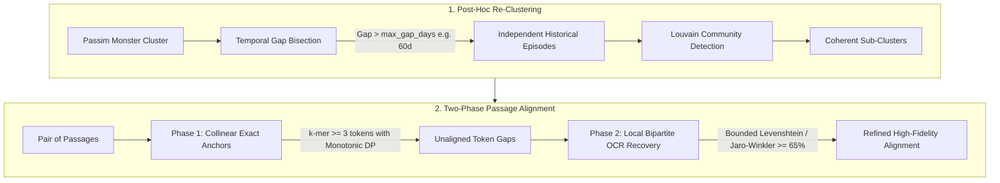

# Text Reuse Cluster & Passage Alignment Refinement

This document provides a comprehensive technical guide to the cluster decomposition and passage alignment refinement algorithms implemented in `impresso-passim`.

---

## 1. Problem Statement & Historical Context

When applying pairwise text reuse detection software such as [`passim`](https://github.com/dasmiq/passim) to historical corpora (spanning 200+ years of newspaper archives with noisy OCR), two major structural failure modes arise:

### 1.1 Monster Drift Clusters (Transitive Chaining)
Passim builds text reuse clusters as connected components of pairwise passage matches. In historical newspapers, recurring legal, financial, or administrative formulas (e.g., *"Convocation à l'Assemblée générale"*, *"Ordre du jour"*, *"Bilan et comptes"*) act as permanent lexical bridges connecting unrelated news stories across decades.

- **Observed Impact**: Giant "monster clusters" emerge (such as cluster `c307` containing **42,220 passages spanning 141 years from 1873 to 2014**). While individual pairwise links have high surface similarity, the cluster as a whole has 0% shared narrative coherence and conflates hundreds of completely independent historical events.

### 1.2 Brittle Passage Boundary Alignment & OCR Corruption
Passim pairs often include surrounding boilerplate or adjacent paragraphs because initial windowing is coarse. Furthermore, historical OCR introduces character substitutions, dropouts, dialectal spelling, and hyphenations (`Lansanne s` $\leftrightarrow$ `Lausanne`, `Monireux` $\leftrightarrow$ `Montreux`, `toajours` $\leftrightarrow$ `toujours`). Standard exact $k$-mer matching either breaks completely at the first OCR typo or produces twisted cross-over matches when text blocks are transposed.

### 1.3 Upstream `lexicaloverlap` Metric Flaw
The original metric computed the mutual $N$-way set intersection of all vocabulary sets in a cluster:
$$\bigcap_{i=1}^N V_i$$
For any cluster of size $N > 3$, this intersection almost always drops to $0.0\%$, making it useless for distinguishing tight wire stories from drifting monster clusters.

---

## 2. Architecture Overview

The refinement system consists of two synergistic layers:



---

## 3. Post-Hoc Re-Clustering (`scripts/post_hoc_clustering.py`)

To break giant transitive drift components into tight, historically meaningful clusters, a two-stage re-clustering procedure is applied:

### 3.1 Temporal Gap Bisection
News events and text reuse stories are naturally bursty. When a cluster spans decades, any time gap exceeding a threshold (default: `max_gap_days = 60`) represents an insurmountable temporal boundary:

1. Passages are sorted chronologically by date.
2. If $\Delta t = t_{i+1} - t_i > \text{max\_gap\_days}$, the cluster is sliced into independent temporal episodes.
3. **Result**: In cluster `c307`, temporal bisection immediately splits 42k passages spanning 141 years into **29 distinct historical episodes**, completely isolating an 1873 financial loan subscription from a 1914 war mobilization notice.

### 3.2 Louvain Community Detection
Within any single temporal episode containing multiple events, a token-Jaccard similarity graph is constructed:
- Nodes: Passages in the episode.
- Edges: Weighted by pairwise token Jaccard similarity:
  $$J(A, B) = \frac{|V_A \cap V_B|}{|V_A \cup V_B|}$$
- Edges with $J(A, B) < \text{similarity\_threshold}$ (default: `0.15`) are pruned.
- The Louvain modularity optimization algorithm partitions the graph into dense community subgraphs.

### 3.3 Sample Pairwise Jaccard Cohesion (`lexicaloverlap`)
The upstream metric in `scripts/postprocess_textreuse_clusters.py` was replaced with deterministic pairwise Jaccard sampling:
$$\text{Cohesion}(C) = \frac{1}{|S|} \sum_{(i, j) \in S} \frac{|V_i \cap V_j|}{|V_i \cup V_j|} \times 100\%$$
where $S$ is sampled up to $M = 50$ pairs deterministically using `random.Random(42)`. This provides a stable $[0\%, 100\%]$ measure of internal lexical cohesion that scales efficiently to clusters of any size.

---

## 4. Two-Phase Passage Alignment (`scripts/alignment_refinement.py`)

Once passages are grouped into coherent clusters, their boundaries and shared textual spans are aligned down to the character level using a two-phase anchor-and-fill algorithm.

### 4.1 Phase 1: Collinear Exact Anchors
Exact word matching is fast and unambiguous, but text reuses often contain insertions, omissions, or transposed blocks (e.g., an agency list moved from bottom to top).

1. **Tokenization with Character Offsets**: Tokens are extracted preserving their exact character start/end coordinates in the raw text:
   `[(start_0, end_0, token_0), ...]`.
2. **$k$-mer Anchoring**: Exact contiguous matches of length $\ge k$ (default: `k = 3` tokens) are identified between passage $A$ and passage $B$.
3. **Monotonic Dynamic Programming Chaining**: To prevent crossing / twisted alignment bounds caused by transposition, candidate anchors are chained by finding the Longest Common Increasing Subsequence of token indices:
   $$\text{Anchor}_1(i_1, j_1) \prec \text{Anchor}_2(i_2, j_2) \iff i_1 + L_1 \le i_2 \text{ and } j_1 + L_1 \le j_2$$
   This guarantees strictly monotonic narrative flow across both documents.

### 4.2 Phase 2: Local Bipartite OCR Gap Resolution
Between each pair of collinear anchors $(\text{Anchor}_k, \text{Anchor}_{k+1})$, there exists an unaligned gap of tokens:
- Gap in $A$: Tokens $[i_k + L_k, \dots, i_{k+1} - 1]$
- Gap in $B$: Tokens $[j_k + L_k, \dots, j_{k+1} - 1]$

Because the gap is tightly bounded by Phase 1 anchors, fuzzy string matching can be performed safely without risk of global drift:
1. **Bipartite Similarity Matrix**: For each token $u \in \text{Gap}_A$ and $v \in \text{Gap}_B$, character similarity is computed via SequenceMatcher ratio:
   $$\text{sim}(u, v) = \frac{2 \cdot M}{|u| + |v|}$$
2. **Greedy Matching**: Pairs with $\text{sim}(u, v) \ge \text{threshold}$ (default: `0.65`) are matched greedily from highest to lowest similarity.
3. **Monotonic Span Resolution**: Matched tokens are tagged as Phase 2 spans and integrated with Phase 1 exact spans.

---

## 5. Production Benchmark Results

The alignment algorithm was benchmarked on production 19th-century Swiss newspaper text reuse from the Impresso corpus (`JDG`, `GAV`, `NV2`):

| Test Case | Archetype | Phase 1 Exact Anchors | Phase 2 OCR Recoveries | Example Recovered OCR Pairs |
|---|---|:---:|:---:|---|
| **Diplomatic Press Dispatch**<br>(JDG vs GAV, 1856-06-13) | Wire dispatch with line breaks & typos | 10 anchors | 12 words | `toajours` $\leftrightarrow$ `toujours` (88%)<br>`lieui` $\leftrightarrow$ `lieux` (80%)<br>`placi` $\leftrightarrow$ `place` (80%)<br>`em-pereur` $\leftrightarrow$ `empereur` (86%) |
| **Pleigne Poisoning Bulletin**<br>(JDG vs GAV, 1856-10-25) | Regional news story | 7 anchors | 5 words | `conslernaiion` $\leftrightarrow$ `consternation` (85%)<br>`entants` $\leftrightarrow$ `enfants` (86%)<br>`délémont` $\leftrightarrow$ `delémont` (88%) |
| **Marché de Sion**<br>(GAV 1856-08-07 vs 1856-12-04) | Tabular commodity prices | 3 anchors | 5 words | `fichelin` $\leftrightarrow$ `ûchelin` (80%)<br>`OrgV` $\leftrightarrow$ `Orge` (75%)<br>`Mais` $\leftrightarrow$ `Maïs` (75%) |
| **Vaud Loan Subscription**<br>(NV2 1873-09-13 vs 1873-09-16) | Complex list & OCR corruption | 10 anchors | 14 words | `Monireux` $\leftrightarrow$ `Montreux` (88%)<br>`Lansanne s` $\leftrightarrow$ `Lausanne` (88%)<br>`vandolse` $\leftrightarrow$ `vaudolse` (88%) |

Interactive visual comparisons can be viewed by opening [`two_phase_ocr_alignment_visualization.html`](two_phase_ocr_alignment_visualization.html) in any browser.

---

## 6. API Reference & Code Usage

### 6.1 Distributed Dask Orchestration Pipeline (`scripts/dask_orchestration_refinement.py`)
To process the entire corpus stored across S3 bz2 partitions in parallel:

```bash
python scripts/dask_orchestration_refinement.py \
    --log-file=logs/refinement_run.log \
    --s3-bucket=41-processed-data-staging \
    --s3-cluster-input=textreuse/textreuse_passim_v1-0-0/results/tr_clusters/ \
    --s3-output-dir=textreuse/textreuse_passim_v1-0-0/results/refined/ \
    --max-gap-days=60 \
    --n-workers=16
```

Pipeline flow:
1. Streams bz2 JSON Lines partitions into distributed Dask Bags.
2. Identifies monster clusters (`size > 100` or `time_delta > 365d`).
3. Breaks monster drift components into episodic sub-clusters using temporal bisection and Louvain community detection.
4. Refines passage boundaries via medoid LCS alignment.
5. Re-partitions and persists refined cluster and passage records back to S3.

### 6.2 Two-Phase Passage Alignment
```python
from scripts.alignment_refinement import align_two_phase_with_ocr

text_a = "A Lausanne: Banque cantonale vandolse ... A Monireux:"
text_b = "A Lausanne: Banque cantonale vaudolse ... A Montreux:"

result = align_two_phase_with_ocr(
    text_a, 
    text_b, 
    min_anchor_tokens=3, 
    ocr_similarity_threshold=0.65
)

print(f"Anchors found: {result['anchor_count']}")
print(f"OCR typo pairs recovered: {len(result['ocr_matches'])}")
for ta, tb, sim in result['ocr_matches']:
    print(f"  Recovered: {ta} <-> {tb} ({sim*100:.1f}%)")

# Exact character spans for highlighting
# result['spans_a'] -> list of (start_char, end_char, 'exact' | 'ocr')
```

### 6.2 Cluster Medoid Refinement
When refining passages across an entire cluster:
```python
from scripts.alignment_refinement import refine_cluster_passages_with_medoid

passages = [
    {"id": "p1", "text": "..."},
    {"id": "p2", "text": "..."},
    {"id": "p3", "text": "..."}
]

refined_passages = refine_cluster_passages_with_medoid(passages)
# Each passage now contains 'refined_begin', 'refined_end', and 'refined_text'
```

### 6.3 Re-Clustering Monster Components
```python
from scripts.post_hoc_clustering import recluster_monster_cluster

cluster_record = {
    "id": "tr-all-v1-24-c307",
    "passages": [...],
    "cluster_size": 42220
}

subclusters = recluster_monster_cluster(
    cluster_record, 
    max_gap_days=60, 
    similarity_threshold=0.15
)

print(f"Broken into {len(subclusters)} coherent historical episodes.")
```

---

## 7. Testing

A complete automated test suite is located in `tests/`:

```bash
PYTHONPATH=. /Users/siclemat/pj/2026/impresso/impresso-reocr-cookbook/.venv/bin/pytest tests/
```

- [`tests/test_lexicaloverlap.py`](tests/test_lexicaloverlap.py): Validates pairwise Jaccard metric, empty cluster handling, and sample stability.
- [`tests/test_alignment_refinement.py`](tests/test_alignment_refinement.py): Tests tokenization offsets, LCS contiguous span extraction, and medoid selection.
- [`tests/test_post_hoc_clustering.py`](tests/test_post_hoc_clustering.py): Tests temporal bisection, date parsing, and Louvain community splitting.
- [`tests/test_two_phase_alignment.py`](tests/test_two_phase_alignment.py): Verifies collinear anchor chaining and OCR typo gap recovery on difficult historic examples.
- [`tests/test_s3_integration.py`](tests/test_s3_integration.py): Live S3 integration tests validating data layouts in buckets `41-processed-data-staging` and `132-component-final`.
