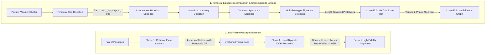

# Text Reuse Cluster & Passage Alignment Refinement

This document provides a comprehensive technical and methodological guide to the cluster decomposition and passage alignment refinement algorithms implemented in `impresso-passim`.

---

## Research-Oriented Summary

Historical newspapers frequently reproduced material from other publications. Identifying these instances of text reuse helps researchers investigate how information circulated, how stories changed as they were republished, and how older texts reappeared in later historical contexts.

However, automatically detecting text reuse in large newspaper collections presents several challenges. Unrelated articles may be grouped together because they contain recurring expressions, while genuinely related texts may be difficult to match because of differences in wording, formatting, or errors introduced during digitization.

The methods described in this document address these problems by improving how reused newspaper passages are grouped, compared, and connected.

The approach distinguishes three aspects of text reuse:

1. **Contemporary circulation**: Identifying groups of related texts published within a relatively short period.
2. **Long-term textual recurrence**: Identifying relationships between similar texts published in different historical periods without treating them as a single continuous circulation event.
3. **Textual correspondence**: Identifying precisely which parts of newspaper articles were reused, including passages affected by transcription errors.

Together, these methods aim to produce more coherent and historically interpretable text reuse data. They support research into both the immediate circulation of news and the longer-term reuse of textual material across generations.

---

## 1. Problem Statement & Historical Context

When applying pairwise text reuse detection software such as [`passim`](https://github.com/dasmiq/passim) to historical corpora (spanning 200+ years of newspaper archives with noisy OCR), two major structural failure modes arise:

### 1.1 Monster Drift Clusters (Transitive Chaining)
Passim builds text reuse clusters as connected components of pairwise passage matches. In historical newspapers, recurring legal, financial, or administrative formulas (e.g., *"Convocation à l'Assemblée générale"*, *"Ordre du jour"*, *"Bilan et comptes"*) act as permanent lexical bridges connecting unrelated news stories across decades.

- **Observed Impact**: Giant "monster clusters" emerge (such as cluster `c307` containing **42,220 passages spanning 141 years from 1873 to 2014**). While individual pairwise links have high surface similarity, the cluster as a whole has 0% shared narrative coherence and conflates hundreds of completely independent historical events.

> [!NOTE]
> **In plain language — Why very large clusters can be misleading**
>
> When the same text appears in several newspapers, we want to identify these publications as instances of text reuse. However, newspapers also repeatedly published standard expressions, such as announcements of public meetings or financial reports.
>
> These recurring expressions can accidentally connect thousands of otherwise unrelated articles. As a result, the system may group together texts published decades apart that have little historical connection.
>
> Our refinement method aims to separate these artificially large groups into smaller collections of articles that genuinely belong together.

### 1.2 Brittle Passage Boundary Alignment & OCR Corruption
Passim pairs often include surrounding boilerplate or adjacent paragraphs because initial windowing is coarse. Furthermore, historical OCR introduces character substitutions, dropouts, dialectal spelling, and hyphenations (`Lansanne s` $\leftrightarrow$ `Lausanne`, `Monireux` $\leftrightarrow$ `Montreux`, `toajours` $\leftrightarrow$ `toujours`). Standard exact $k$-mer matching either breaks completely at the first OCR typo or produces twisted cross-over matches when text blocks are transposed.

> [!NOTE]
> **In plain language — Finding the text that was actually reused**
>
> Historical newspapers were digitized using optical character recognition (OCR), which converts scanned pages into searchable text. This process frequently introduces errors, especially in older newspapers.
>
> For example, the place name *Montreux* might be recognized as *Monireux*. Two newspapers may therefore contain essentially the same text even though their digitized versions differ.
>
> Our method identifies the portions of text that correspond across publications, tolerates common transcription errors, and excludes surrounding material that was not part of the reuse.

### 1.3 Upstream `lexicaloverlap` Metric Flaw
The original metric computed the mutual $N$-way set intersection of all vocabulary sets in a cluster:
$$\bigcap_{i=1}^N V_i$$
For any cluster of size $N > 3$, this intersection almost always drops to $0.0\%$, making it useless for distinguishing tight wire stories from drifting monster clusters.

---

## 2. Architecture Overview

The refinement system consists of two synergistic layers:



> [!NOTE]
> **In plain language — How the refinement process works**
>
> The refinement process improves text reuse detection in two complementary ways.
>
> First, it examines groups of potentially related newspaper passages and separates those that belong to different historical events or textual traditions.
>
> Second, it compares the passages within these groups more precisely to determine which words and sentences were actually reused, even when the digitized text contains errors.
>
> The result is a more reliable representation of how newspaper content circulated, was reproduced, and changed over time.

---

## 3. Temporal Episode Decomposition & Cross-Episode Linkage (`scripts/post_hoc_clustering.py`)

To break giant transitive drift components into tight, historically meaningful units without severing genuine diachronic connections (such as 50- or 100-year commemorative reprints), the refinement pipeline implements a two-stage procedure: **Temporal Episode Decomposition** followed by **Cross-Episode Textual Linkage**.

### 3.1 Methodological Distinctions: Episodes, Relations, and Transmission

When clustering text reuse across centuries, the system explicitly separates clustering mechanics from historical interpretation:

| Entity | Analytical Meaning | Computational Definition | Primary Purpose |
| :--- | :--- | :--- | :--- |
| **Episode** | Temporally and lexically coherent reuse cluster | Synchronic group bounded by `time_delta <= max_gap_days` and dense internal LCS connectivity | Study synchronic news diffusion and contemporary circulation |
| **Episode Relation** | Evidence-supported textual similarity between two episodes | Verified contiguous text alignment between episode prototypes (`>= K_tokens` or Phase 2 alignment score) | Study diachronic reuse, reception, and candidate recurrence |
| **Historical Transmission** | Directional lineage from source to descendant | **Not inferred automatically by algorithm**; requires domain/provenance metadata | Preserve candidate links for digital historians to evaluate |

> [!NOTE]
> **In plain language — A text can have more than one historical life**
>
> Imagine that a political declaration was published in several newspapers in 1820. One hundred years later, newspapers reproduced parts of the same declaration to commemorate its anniversary.
>
> These publications are related because they contain the same historical text. However, they represent two different moments of circulation.
>
> Our approach preserves this distinction. It groups publications from 1820 into one episode and those from 1920 into another, while recording the textual relationship between them.
>
> Historians can therefore investigate both how information circulated at a particular moment and how older texts were rediscovered, reproduced, or reinterpreted by later generations.

> [!IMPORTANT]
> **Lineage Membership vs. Demonstrated Transmission (Similar texts do not prove direct copying)**:
>
> When two newspapers publish similar texts, we can establish that their wording is related. However, this does not tell us exactly how the text traveled between them.
>
> A later newspaper might have copied an earlier newspaper, but it might also have used a book, an official publication, an archive, or another source that is not represented in the collection.
>
> The system therefore identifies textual relationships without automatically claiming direct transmission between publications. Establishing the historical circumstances of transmission remains a task for researchers, potentially supported by additional documentary evidence.

---

### 3.2 Step 1: Temporal Gap Bisection
News events and text reuse stories are naturally bursty. When a cluster spans decades, any time gap exceeding a threshold (default: `max_gap_days = 60`) represents an insurmountable temporal boundary for contemporary circulation:

1. Passages within a monster component are sorted chronologically by publication date.
2. If `delta_t = t_{i+1} - t_i > max_gap_days`, the cluster is sliced into independent temporal episodes.
3. **Result**: In cluster `c307`, temporal bisection immediately splits 42k passages spanning 141 years into **29 distinct historical episodes**, completely isolating an 1873 financial loan subscription from a 1914 war mobilization notice.

> [!NOTE]
> **In plain language — Separating different moments of circulation**
>
> Newspaper stories often circulate intensively over a relatively short period. A report might appear in several newspapers over a few days or weeks and then disappear.
>
> If similar text reappears decades later, it may represent a different historical phenomenon, such as a retrospective article or commemorative reprint.
>
> The system therefore separates periods of circulation when sufficiently long gaps occur between publications. This allows researchers to study individual episodes of news circulation without confusing them with much later appearances of similar texts.
>
> *Methodological qualification:* The 60-day threshold is an operational parameter tuned for historical press dynamics, not a universal historical law. It can be adjusted depending on publication frequency and corpus characteristics.

---

### 3.3 Step 2: Louvain Community Detection (Within-Episode)
Within any single temporal episode containing multiple events, a token-Jaccard similarity graph is constructed:
- Nodes: Passages in the episode.
- Edges: Weighted by pairwise token Jaccard similarity:
  $$J(A, B) = \frac{|V_A \cap V_B|}{|V_A \cup V_B|}$$
- Edges with $J(A, B) < 0.15$ (default `similarity_threshold`) are pruned.
- The Louvain modularity optimization algorithm partitions the graph into dense community subgraphs, separating coincidental administrative formulas from core narrative stories.

> [!NOTE]
> **In plain language — Distinguishing different stories published at the same time**
>
> Articles published around the same date do not necessarily concern the same event.
>
> For example, newspapers might publish reports about a railway accident, parliamentary proceedings, and financial announcements during the same week.
>
> The system compares the vocabulary of these texts and identifies groups whose members share relatively similar wording. This helps distinguish separate stories even when they circulated during the same period. However, shared vocabulary alone does not guarantee that the articles concern the same historical event.

---

### 3.4 Step 3: Cross-Episode Textual Linkage

While temporal bisection successfully halts transitive drift across decades, a pure chronological cut would permanently sever long-range historical reprinting (e.g. an 1820 proclamation reprinted verbatim in 1920). 

To restore these connections without re-creating monster drift, cross-episode linkage runs across the decomposed episodes:

#### 1. Multi-Prototype Episode Signatures (Avoiding Single-Medoid Blind Spots)
A single episode medoid can miss genuine historical relationships when an episode contains multiple textual variants (e.g. an 1820 episode containing 10 short telegram summaries and 1 complete declaration; a simple medoid would select the short summary, missing a 1920 reprint of the full declaration).
The system selects a prototype budget $K \in [2, 4]$ per episode:
- **Longest Variant**: Captures the maximal unabbreviated text form.
- **Centroid / Medoid**: Captures the consensus/dominant form.
- **Residual Modality**: Captures high-variance sub-branches if the episode has multiple internal communities.

> [!NOTE]
> **In plain language — Comparing groups without reading every article**
>
> A group of related newspaper articles may contain several versions of the same text. Some reproduce the complete original, while others publish shortened or modified versions.
>
> Instead of comparing every article with every article in another group, the system selects a small number of representative passages. These capture different versions of the text, including longer and shorter forms.
>
> This makes it possible to identify similarities between groups more efficiently while reducing the risk of overlooking relationships that involve less common textual variants.

#### 2. Two-Stage Candidate Filtering and Alignment Verification
- **Candidate Generation**: Lightweight token-vocabulary overlap (MinHash / token Jaccard $\ge 0.20$) evaluates prototype pairs across episodes.
- **Link Verification**: Candidates are validated using strict contiguous token alignment (`longest_contiguous_matching_span` with $\ge 25$ words) or Phase 2 bounded Levenshtein alignment. Bag-of-words formula false-positives are discarded.

> [!NOTE]
> **In plain language — Checking whether two episodes really share text**
>
> Two groups of newspaper articles may contain similar vocabulary without reproducing the same text. For example, reports about parliamentary elections may repeatedly use the same political terminology.
>
> The system therefore checks potential relationships in two steps. First, it identifies groups that share enough vocabulary to justify further comparison. Second, it examines whether their passages contain substantial sequences of corresponding words.
>
> This additional verification helps distinguish actual textual reuse from superficial similarities caused by recurring expressions or common subject matter.

#### 3. Graph Adjacency vs. Transitive Family Drift
Cross-episode relations are stored as an **attributed adjacency graph** ($G = (V_{\text{episodes}}, E_{\text{relations}})$), **not** merged into flat connected components. Merging episodes via blind graph transitivity would reproduce the exact same monster drift at the episode level ($A \sim B \sim C$). Sub-clusters remain independent analytical entities carrying explicit `cross_episode_relations` metadata pointers.

> [!NOTE]
> **In plain language — Keeping related episodes separate**
>
> Suppose a newspaper text from 1820 resembles one published in 1850, and the 1850 version resembles another published in 1920. This does not necessarily mean that the texts from 1820 and 1920 are themselves closely similar.
>
> Rather than combining all three episodes into one large group, the system records the relationships between them individually.
>
> This preserves evidence of long-term textual connections without assuming that every indirectly connected article belongs to the same historical story.

---

### 3.5 Computational Complexity Profile

The computational cost of post-hoc refinement is decomposed as follows:

| Stage | Operation | Complexity | Typical Runtime Profile |
| :--- | :--- | :--- | :--- |
| **Bisection** | Chronological sort & gap scan | $O(N \log N) + O(N)$ | $< 0.01\text{s}$ for 40k passages |
| **Within-Episode Community** | Pairwise LCS / Louvain on episode $n$ | $\sum O(n_k^2 \cdot L)$ | **Dominant step:** seconds for $n_k \le 500$; requires LSH pre-filtering if $n_k > 2000$ |
| **Candidate Filtering** | Set intersection of $K$ prototypes across $M$ episodes | $O(M^2 \cdot K^2)$ | $< 0.01\text{s}$ ($M=30, K=3 \implies 405$ prototype pairs) |
| **Link Verification** | Contiguous DP alignment on candidate pairs | $O(C \cdot L)$ | $< 0.05\text{s}$ (evaluates only the $<5\%$ passing candidates) |

Splitting $N = 40,000$ into $M = 29$ episodes of $n_k \approx 500$ reduces the pairwise comparison space from $\frac{N(N-1)}{2} \approx 800\text{M}$ to $\sum \frac{n_k^2}{2} \approx 3.6\text{M}$ pairs—a **$220\times$ speedup**—while cross-episode linkage adds negligible overhead.

---

### 3.6 Sample Pairwise Jaccard Cohesion (`lexicaloverlap`)
The upstream metric in `scripts/postprocess_textreuse_clusters.py` was replaced with deterministic pairwise Jaccard sampling:
$$\text{Cohesion}(C) = \frac{1}{|S|} \sum_{(i, j) \in S} \frac{|V_i \cap V_j|}{|V_i \cup V_j|} \times 100\%$$
where $S$ is sampled up to $M = 50$ pairs deterministically using `random.Random(42)`. This provides a stable $[0\%, 100\%]$ measure of internal lexical cohesion that scales efficiently to clusters of any size.

> [!NOTE]
> **In plain language — Measuring how closely the texts resemble one another**
>
> Once articles have been grouped together, researchers need a way to assess how similar their wording actually is.
>
> The system calculates a score based on the vocabulary shared between pairs of passages. Higher scores indicate greater lexical similarity within the group.
>
> This measure helps identify groups containing closely related texts and those that may still combine different material.
>
> *Cautionary note:* Lexical similarity measures resemblance in wording, not necessarily similarity in meaning or historical context.

---

## 4. Two-Phase Passage Alignment (`scripts/alignment_refinement.py`)

Once passages are grouped into coherent clusters, their boundaries and shared textual spans are aligned down to the character level using a two-phase anchor-and-fill algorithm.

> [!NOTE]
> **In plain language — Identifying reused passages despite transcription errors**
>
> Consider two newspapers that published nearly identical reports. One version contains additional sentences, while the other has several OCR errors.
>
> The system first identifies sequences of words that match exactly and appear in the same order. It then examines the intervening passages to find words that are probably equivalent despite minor spelling or recognition differences.
>
> This produces a more precise identification of the reused text and makes it possible to highlight corresponding passages in different newspaper articles.

### 4.1 Phase 1: Collinear Exact Anchors
Exact word matching is fast and unambiguous, but text reuses often contain insertions, omissions, or transposed blocks (e.g., an agency list moved from bottom to top).

1. **Tokenization with Character Offsets**: Tokens are extracted preserving their exact character start/end coordinates in the raw text:
   `[(start_0, end_0, token_0), ...]`.
2. **$k$-mer Anchoring**: Exact contiguous matches of length $\ge k$ (default: `k = 3` tokens) are identified between passage $A$ and passage $B$.
3. **Monotonic Dynamic Programming Chaining**: To prevent crossing / twisted alignment bounds caused by transposition, candidate anchors are chained by finding the Longest Common Increasing Subsequence of token indices:
   $$\text{Anchor}_1(i_1, j_1) \prec \text{Anchor}_2(i_2, j_2) \iff i_1 + L_1 \le i_2 \text{ and } j_1 + L_1 \le j_2$$
   This guarantees strictly monotonic narrative flow across both documents.

### 4.2 Phase 2: Local Bipartite OCR Gap Resolution
Between each pair of collinear anchors $(\text{Anchor}_k, \text{Anchor}_{k+1})$, there exists an unaligned gap of tokens:
- Gap in $A$: Tokens $[i_k + L_k, \dots, i_{k+1} - 1]$
- Gap in $B$: Tokens $[j_k + L_k, \dots, j_{k+1} - 1]$

Because the gap is tightly bounded by Phase 1 anchors, fuzzy string matching can be performed safely without risk of global drift:
1. **Bipartite Similarity Matrix**: For each token $u \in \text{Gap}_A$ and $v \in \text{Gap}_B$, character similarity is computed via SequenceMatcher ratio:
   $$\text{sim}(u, v) = \frac{2 \cdot M}{|u| + |v|}$$
2. **Greedy Matching**: Pairs with $\text{sim}(u, v) \ge \text{threshold}$ (default: `0.65`) are matched greedily from highest to lowest similarity.
3. **Monotonic Span Resolution**: Matched tokens are tagged as Phase 2 spans and integrated with Phase 1 exact spans.

---

## 5. Production Benchmark Results

The alignment algorithm was benchmarked on production 19th-century Swiss newspaper text reuse from the Impresso corpus (`JDG`, `GAV`, `NV2`):

| Test Case | Archetype | Phase 1 Exact Anchors | Phase 2 OCR Recoveries | Example Recovered OCR Pairs |
|---|---|:---:|:---:|---|
| **Diplomatic Press Dispatch**<br>(JDG vs GAV, 1856-06-13) | Wire dispatch with line breaks & typos | 10 anchors | 12 words | `toajours` $\leftrightarrow$ `toujours` (88%)<br>`lieui` $\leftrightarrow$ `lieux` (80%)<br>`placi` $\leftrightarrow$ `place` (80%)<br>`em-pereur` $\leftrightarrow$ `empereur` (86%) |
| **Pleigne Poisoning Bulletin**<br>(JDG vs GAV, 1856-10-25) | Regional news story | 7 anchors | 5 words | `conslernaiion` $\leftrightarrow$ `consternation` (85%)<br>`entants` $\leftrightarrow$ `enfants` (86%)<br>`délémont` $\leftrightarrow$ `delémont` (88%) |
| **Marché de Sion**<br>(GAV 1856-08-07 vs 1856-12-04) | Tabular commodity prices | 3 anchors | 5 words | `fichelin` $\leftrightarrow$ `ûchelin` (80%)<br>`OrgV` $\leftrightarrow$ `Orge` (75%)<br>`Mais` $\leftrightarrow$ `Maïs` (75%) |
| **Vaud Loan Subscription**<br>(NV2 1873-09-13 vs 1873-09-16) | Complex list & OCR corruption | 10 anchors | 14 words | `Monireux` $\leftrightarrow$ `Montreux` (88%)<br>`Lansanne s` $\leftrightarrow$ `Lausanne` (88%)<br>`vandolse` $\leftrightarrow$ `vaudolse` (88%) |

Interactive visual comparisons can be viewed by opening [`two_phase_ocr_alignment_visualization.html`](two_phase_ocr_alignment_visualization.html) in any browser.

---

## 6. API Reference & Code Usage

### 6.1 Distributed Dask Orchestration Pipeline (`scripts/dask_orchestration_refinement.py`)
To process the entire corpus stored across S3 bz2 partitions in parallel:

```bash
python scripts/dask_orchestration_refinement.py \
    --log-file=logs/refinement_run.log \
    --s3-bucket=41-processed-data-staging \
    --s3-cluster-input=textreuse/textreuse_passim_v1-0-0/results/tr_clusters/ \
    --s3-output-dir=textreuse/textreuse_passim_v1-0-0/results/refined/ \
    --max-gap-days=60 \
    --n-workers=16
```

Pipeline flow:
1. Streams bz2 JSON Lines partitions into distributed Dask Bags.
2. Identifies monster clusters (`size > 100` or `time_delta > 365d`).
3. Breaks monster drift components into episodic sub-clusters using temporal bisection and Louvain community detection.
4. Refines passage boundaries via medoid LCS alignment.
5. Re-partitions and persists refined cluster and passage records back to S3.

### 6.2 Two-Phase Passage Alignment
```python
from scripts.alignment_refinement import align_two_phase_with_ocr

text_a = "A Lausanne: Banque cantonale vandolse ... A Monireux:"
text_b = "A Lausanne: Banque cantonale vaudolse ... A Montreux:"

result = align_two_phase_with_ocr(
    text_a, 
    text_b, 
    min_anchor_tokens=3, 
    ocr_similarity_threshold=0.65
)

print(f"Anchors found: {result['anchor_count']}")
print(f"OCR typo pairs recovered: {len(result['ocr_matches'])}")
for ta, tb, sim in result['ocr_matches']:
    print(f"  Recovered: {ta} <-> {tb} ({sim*100:.1f}%)")

# Exact character spans for highlighting
# result['spans_a'] -> list of (start_char, end_char, 'exact' | 'ocr')
```

### 6.2 Cluster Medoid Refinement
When refining passages across an entire cluster:
```python
from scripts.alignment_refinement import refine_cluster_passages_with_medoid

passages = [
    {"id": "p1", "text": "..."},
    {"id": "p2", "text": "..."},
    {"id": "p3", "text": "..."}
]

refined_passages = refine_cluster_passages_with_medoid(passages)
# Each passage now contains 'refined_begin', 'refined_end', and 'refined_text'
```

### 6.3 Re-Clustering Monster Components
```python
from scripts.post_hoc_clustering import recluster_monster_cluster

cluster_record = {
    "id": "tr-all-v1-24-c307",
    "passages": [...],
    "cluster_size": 42220
}

subclusters = recluster_monster_cluster(
    cluster_record, 
    max_gap_days=60, 
    similarity_threshold=0.15
)

print(f"Broken into {len(subclusters)} coherent historical episodes.")
```

---

## 7. Testing

A complete automated test suite is located in `tests/`:

```bash
PYTHONPATH=. /Users/siclemat/pj/2026/impresso/impresso-reocr-cookbook/.venv/bin/pytest tests/
```

- [`tests/test_lexicaloverlap.py`](tests/test_lexicaloverlap.py): Validates pairwise Jaccard metric, empty cluster handling, and sample stability.
- [`tests/test_alignment_refinement.py`](tests/test_alignment_refinement.py): Tests tokenization offsets, LCS contiguous span extraction, and medoid selection.
- [`tests/test_post_hoc_clustering.py`](tests/test_post_hoc_clustering.py): Tests temporal bisection, date parsing, and Louvain community splitting.
- [`tests/test_two_phase_alignment.py`](tests/test_two_phase_alignment.py): Verifies collinear anchor chaining and OCR typo gap recovery on difficult historic examples.
- [`tests/test_s3_integration.py`](tests/test_s3_integration.py): Live S3 integration tests validating data layouts in buckets `41-processed-data-staging` and `132-component-final`.
